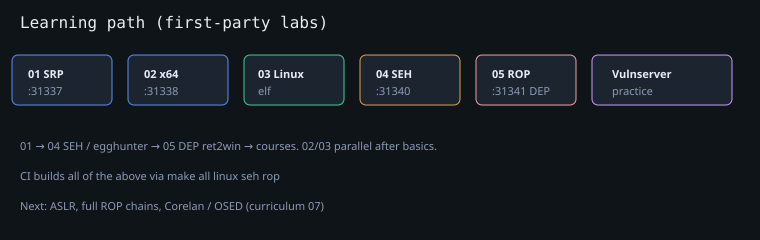

# do buffer overflow better

A **2026-ready curriculum** for learning classic stack buffer overflows as the
stepping stone into exploit writing — with **WinDBG**, **mona3**, **Python 3**,
and modernized intentionally vulnerable labs (x86 **and** x64).

> Stack smashing is not new, and real-world mitigations (ASLR, DEP/NX, stack
> canaries, CFG, …) make production exploitation hard. That is intentional:
> you still learn the mechanics *with mitigations off*, then layer defenses
> and bypasses on top. This repo is that first ladder.

Inspired by (and deeply indebted to):

- [justinsteven/dostackbufferoverflowgood](https://github.com/justinsteven/dostackbufferoverflowgood) — the classic free Win32 “pop calc” courseware
- [Corelan](https://www.corelan.be/) free tutorials, WinDBG guides, training scripts, and [mona3](https://github.com/corelan/mona3)

See [third_party/NOTICE.md](third_party/NOTICE.md) for full attribution.

---

## Who this is for

- People who want a **ground-up Windows path**: assembly/stack → EIP/RIP control → shellcode → “what next?”
- Students building an isolated **Win10/11 + FLARE-VM / Corelan-style lab**
- Anyone refreshing classic BOFs with **current tooling** (WinDBGX, mona3, Python 3)

**Not** for: weaponizing real software, attacking systems you do not own, or skipping ethics. All targets here are intentional lab binaries.

---

## Repo map

| Path | Purpose |
|------|---------|
| [curriculum/](curriculum/) | Ordered modules + external resource links |
| [setup/](setup/) | mona3 mirror/install scripts, Win11 lab notes, WinDBG helpers |
| [labs/01-x86-stack-bof/](labs/01-x86-stack-bof/) | Modernized x86 TCP lab (dostackbufferoverflowgood spirit) |
| [labs/02-x64-stack-bof/](labs/02-x64-stack-bof/) | x64 stack overflow companion lab |
| [labs/03-linux-stack-bof/](labs/03-linux-stack-bof/) | Linux ELF companion (mitigations off) |
| [labs/04-x86-seh-bof/](labs/04-x86-seh-bof/) | x86 SEH overwrite lab (+ egghunter tutorial) |
| [labs/05-x86-dep-rop/](labs/05-x86-dep-rop/) | DEP-on ROP intro (ret2win + VP layout) |
| [labs/06-x64-dep-rop/](labs/06-x64-dep-rop/) | x64 DEP-on ret2win |
| [labs/07-linux-nx-ret2win/](labs/07-linux-nx-ret2win/) | Linux NX ret2win (host-tested) |
| [labs/08-aarch64-stack-bof/](labs/08-aarch64-stack-bof/) | AArch64 companion (cross or native) |
| [labs/shared/mingw-offset-appendix.md](labs/shared/mingw-offset-appendix.md) | Offsets + `make meta` generator |
| [labs/vulnserver-practice/](labs/vulnserver-practice/) | Vulnserver fuzz/pattern skeletons |
| [BUILDING.md](BUILDING.md) | MinGW / MSVC / MSYS2 / Linux build matrix |
| [ROADMAP.md](ROADMAP.md) | Done vs nice-to-have |
| [docs/](docs/) | Diagrams + WinDBG session maps |
| [tools/](tools/) | Local mirrors (mona3, etc.) — **gitignored**, filled by scripts |
| [third_party/NOTICE.md](third_party/NOTICE.md) | Licenses and credits |

---

## Suggested path (zero → shell)

```text
1. Platform   → curriculum/01-platform.md
2. Tools      → curriculum/02-tools.md + setup/
3. Concepts   → labs/01-x86-stack-bof              (EIP → JMP ESP → shellcode)
4. Practice   → labs/vulnserver-practice + curriculum/04-*
5. x64        → labs/02-x64-stack-bof
6. Linux opt. → labs/03-linux-stack-bof
7. SEH        → labs/04-x86-seh-bof + curriculum/08-seh-and-beyond.md
8. DEP/ROP    → labs/05-x86-dep-rop + labs/06-x64-dep-rop + curriculum/09-dep-rop.md
9. Next       → curriculum/07-next-level.md        (courses, ASLR, modern)
```



Full module index: [curriculum/README.md](curriculum/README.md).

---

## Quick start (Windows 11 lab VM)

1. **Snapshot** a clean Windows 10/11 VM (host-only network for isolated work).
2. Install tools (pick one track):
   - **FLARE-VM**: [mandiant/flare-vm](https://github.com/mandiant/flare-vm)
   - **Corelan scripts**: [corelan/CorelanTraining](https://github.com/corelan/CorelanTraining) (`CorelanWin11VMInstall.ps1`, `CorelanPyKDInstall.ps1`)
3. From this repo on the VM (or a shared folder):

   ```powershell
   # From an elevated PowerShell
   cd path\to\dobufferoverflowbetter
   .\setup\scripts\Mirror-Mona3.ps1
   .\setup\scripts\Install-Mona3.ps1
   .\setup\scripts\Verify-MonaSetup.ps1
   ```

4. Read [setup/win11-lab-notes.md](setup/win11-lab-notes.md).
5. Build and run lab 01:

   ```powershell
   cd labs\01-x86-stack-bof
   # MSVC: nmake -f Makefile.nmake
   # or MinGW: mingw32-make
   .\bin\dobetter_x86.exe
   ```

6. Attach WinDBG, load mona (`!mona`), work through [labs/01-x86-stack-bof/TUTORIAL.md](labs/01-x86-stack-bof/TUTORIAL.md).

Linux hosts can mirror mona3 for packaging and cross-compile labs with MinGW:

```bash
./setup/scripts/Mirror-Mona3.sh
# sudo apt install mingw-w64 make
make              # labs 01 + 02 (MINGW_CC, not host CC)
make linux        # lab 03 ELF
make seh          # lab 04 SEH PE
make rop          # lab 05 DEP-on ROP x86
make rop64        # lab 06 DEP-on ROP x64
make linux-ret2win
make aarch64      # needs gcc-aarch64-linux-gnu
make meta         # regenerate offset appendix from binaries
```

Full build matrix: [BUILDING.md](BUILDING.md). Status: [ROADMAP.md](ROADMAP.md).

---

## What “better” means vs the 2016 classic

| Classic (dostackbufferoverflowgood) | This project |
|-------------------------------------|--------------|
| Immunity Debugger + mona (Py2 era) | WinDBG Classic / WinDBGX + **mona3** |
| Python 2 exploit scripts | **Python 3** only |
| x86 only | **x86 + x64** labs |
| Implicit JMP ESP via huge stack frame | **Explicit teaching gadgets** + mona still works |
| PDF-centric long tutorial | Modular curriculum + lab tutorials + progressive scripts |
| Mitigations “off by compiler flags” | Same + **Win11 Exploit Protection** lab notes |

The classic remains excellent. Use both: [original tutorial](https://github.com/justinsteven/dostackbufferoverflowgood) for narrative depth; this repo for 2026 tooling and structure.

---

## Safety and ethics

- Run vulnerable binaries **only** in disposable VMs.
- Disable Defender / Exploit Protection **only** for lab targets, not your daily driver.
- Do not point exploit scripts at systems without authorization.
- Shellcode examples are for **local lab learning** (e.g. `calc.exe` / message box patterns via msfvenom on your attacker box).

---

## License

- **Code and original materials in this repository**: [Apache License 2.0](LICENSE)
- **Curriculum text**: Apache 2.0 (attribution appreciated)
- **Third-party tools** (mona3, FLARE-VM, …): their own licenses — see [third_party/NOTICE.md](third_party/NOTICE.md)

`dostackbufferoverflowgood` tutorial/slides are CC-BY-4.0 by Justin Steven; we do **not** relicense that content. We reimplement the *pedagogy* with new code and WinDBG-first docs.

---

## Contributing

PRs welcome: clearer explanations, more progressive scripts, extra architectures, screenshot updates for WinDBGX, and Linux companions that stay “mitigations-off first.”
