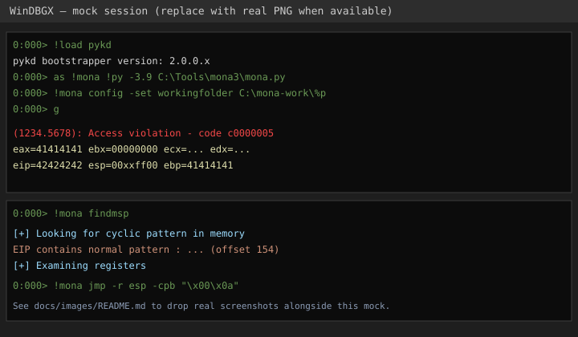
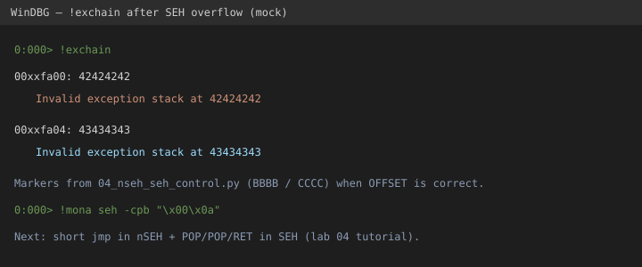

# WinDBG session map (text “screenshots”)

Diagrams: [images/](images/).

Mocks (until real PNGs land):





## Attach and load mona

```text
Microsoft (R) Windows Debugger ...
*** wait for attach ***

0:000> !load pykd
0:000> !pykd.info
pykd bootstrapper version: 2.0.0.x
Installed python:
  3.9 x86 ...
0:000> as !mona !py -3.9 C:\Tools\mona3\mona.py
0:000> !mona config -set workingfolder C:\mona-work\%p
0:000> g
```

## After a crash (x86 lab)

```text
(xxxx.xxxx): Access violation - code c0000005
eax=... ebx=... ecx=... edx=... esi=... edi=...
eip=41414141 esp=00xxffxx ebp=41414141
...

0:00x> r
0:00x> dps esp L20
00xxffxx  41414141
00xxffyy  41414141
...

0:00x> !mona findmsp
[+] Looking for cyclic pattern in memory
... EIP contains normal pattern : ... (offset XXX)
```

## Confirm EIP control

```text
eip=42424242   # from exploits/04_eip_control.py marker BBBB
```

## JMP ESP hit

```text
0:00x> u 0040151c L1
dobetter_x86!gadget_jmp_esp:
0040151c ff e4    jmp     esp
```

*(Address is illustrative — use mona on your build.)*

## WinDBGX notes

- Architecture follows the target process.
- Startup commands: [../setup/windbg/windbgx-startup.txt](../setup/windbg/windbgx-startup.txt)
- Command window mona usage is the same `!mona ...` once the alias exists.
